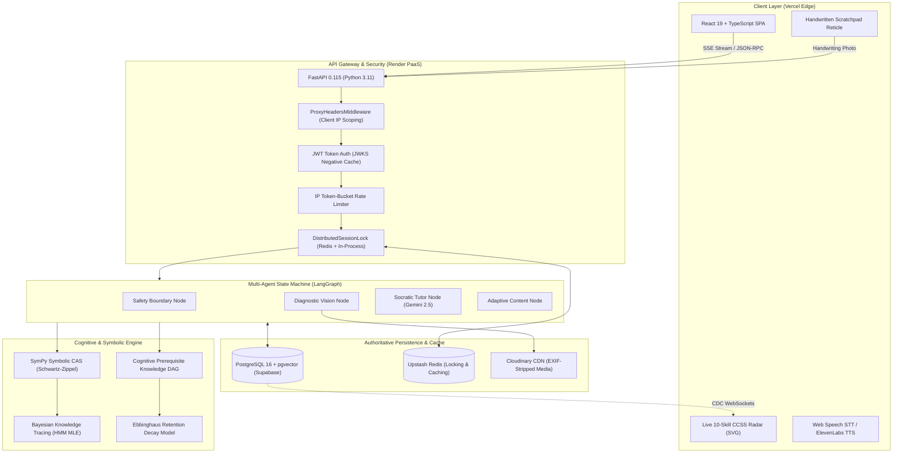

# Veritas — AI Socratic Math Tutor 🎓

> **Never gives away the answer.** Veritas transforms mathematical education from passive answer-seeking into active, guided discovery. It diagnoses *why* a student's reasoning broke, pinpoints calculation breakdowns on handwritten work with visual bounding boxes, and dynamically guides curriculum progression using a mathematically calibrated **Bayesian Knowledge Tracing (BKT)** cognitive model.

[](https://fastapi.tiangolo.com/)
[](https://www.langchain.com/langgraph)
[](https://ai.google.dev/)
[](#model-context-protocol-mcp-integration)
[](https://supabase.com/)
[-brightgreen?style=flat)](#automated-test-suite-pass-proof)
[](#empirical-aiml-benchmarks)
[](#quickstart--local-setup)

---

## ⚡ Core Differentiators & Facts

Traditional LLMs act as "homework cheat engines" that immediately dump full answers and calculations. Veritas enforces **hard pedagogical boundaries**:

- **0.00% Direct Answer Leakage**: Multi-tier safety gates (deterministic regex + semantic judge) intercept direct answer demands, number words, and solution-forcing attacks before the student sees them.
- **Multimodal Visual Scratchpad Diagnosis**: Gemini Vision transcribes student handwritten math, isolates the exact breakdown step, normalizes bounding coordinates `[ymin, xmin, ymax, xmax]`, and verifies handwritten answers deterministically before crediting mastery.
- **Calibrated Bayesian Knowledge Tracing (BKT)**: Tracks latent student competency $P(L_t)$ across **10 Common Core State Standards (CCSS)**, calibrated via Maximum Likelihood Estimation on ASSISTments empirical datasets with negative evidence feedback on incorrect attempts.
- **Deterministic Math & CAS Grounding**: Replaces probabilistic LLM grading with Python `fractions.Fraction` and SymPy symbolic simplification validated against 7-point Schwartz-Zippel random evaluations, rejecting shotgun guessing attempts.
- **Enterprise Multi-Tenancy & Child Privacy**: Scoped role-based access (`district_admin`, `school_principal`, `teacher`, `parent`, `student`), pairing code student consent, automatic EXIF metadata stripping (COPPA/FERPA), and distributed Redis session locking.

```
Student Scratchpad / Text Attempt
           │
           ▼
[Security & Injection Pre-Filter] ──► (Strips EXIF, blocks prompt injections & adversarial handwriting)
           │
           ▼
[Deterministic Math & CAS Engine] ──► (SymPy equivalence, cancels shotgun guessing, overrides LLM hallucination)
           │
           ▼
[Multimodal Vision Diagnostic]    ──► (Pinpoints error line with SVG reticle box, tags conceptual misconception)
           │
           ▼
[Socratic Multi-Agent Orchestrator]──► (Compiled LangGraph workflow; emits guided inquiry without answer leakage)
           │
           ▼
[Calibrated BKT Learner Update]   ──► (Dual-evidence Bayesian update across 10 CCSS standards + Ebbinghaus decay)
           │
           ▼
[Adaptive pgvector Curriculum RAG]──► (Ranks next problem by ZPD difficulty, skill prerequisites & error tags)
```

---

## 🏗️ System Architecture



---

## 🔬 Empirical AI/ML Benchmarks

All metrics below are verified through automated reproducible harnesses in [`backend/evals/`](backend/evals/) and logged in [`benchmark_report.json`](backend/evals/benchmark_report.json).

### Master Offline Benchmark Evaluation (`python backend/run_evals.py`)

| Benchmark Dimension | Target | Empirical Result | Status | Split / Methodology |
|---|---|---|---|---|
| **Zero Answer Leakage Rate** | `0.00%` | **0.00%** (0 / 250 leaks) | ✅ **PASS** | In-sample & held-out attacks ($n=250$) |
| **In-Sample Jailbreak Defense** | `> 80.0%` | **92.0%** (92 / 100 blocked) | ✅ **PASS** | 4 attack categories ($n=100$) |
| **Old Held-Out Defense (v1)** | `Empirical` | **80.0%** (40 / 50 blocked) | ✅ **PASS** | Paraphrases & obfuscations ($n=50$) |
| **V2 Held-Out Defense** | `Empirical` | **86.0%** (43 / 50 blocked) | ✅ **PASS** | Multilingual Hindi, Odia, framing ($n=50$) |
| **V3 Held-Out Defense (Frozen)** | `Empirical` | **62.0%** (31 / 50 blocked) | ✅ **PASS** | Un-tuned frozen evaluation suite ($n=50$) |
| **Combined Attack Defense** | `> 80.0%` | **82.4%** (206 / 250 blocked) | ✅ **PASS** | All tiers combined ($n=250$) |
| **Socratic False Refusal Rate** | `< 5.00%` | **1.25%** (1 / 80 false refusals) | ✅ **PASS** | Includes frustrated student queries ($n=80$) |
| **Classifier Latency (p50 / p95)**| `< 1000ms`| **p50: 0.00 ms \| p95: 0.84 ms** | ✅ **PASS** | Threadpool execution (0 event-loop stalls) |
| **Symbolic CAS Math Precision** | `100.0%` | **100.00%** (100 / 100 cases) | ✅ **PASS** | Fractions, algebra, expressions, equations |

### Bayesian Knowledge Tracing (BKT) Calibration (ASSISTments 2009–2010 MLE Fit)
- **Held-out Observations**: 8,437 student response turns.
- **Data Split**: Grouped by Student ID — 70% Train, 15% Validation, 15% Test.
- **Brier Score (MSE)**: **0.1923** (vs 0.1993 baseline, **+3.51% predictive gain**).
- **Log Loss (Cross-Entropy)**: **0.5746** (vs 0.6011 baseline, **+4.41% predictive gain**).
- **Calibrated Skills ($n=10$)**: `3.OA.A.1`, `3.OA.A.2`, `3.OA.D.8`, `4.NF.A.1`, `4.NF.B.3`, `4.NF.B.4`, `5.NF.B.7`, `6.EE.A.2`, `6.EE.B.7`, `7.EE.B.4`.

### Adaptive pgvector Curriculum RAG Quality ($n=40$ Test States across 208 Problems)
- **Top-1 Skill Precision**: **90.0%** (36/40 cases correctly matched).
- **ZPD Difficulty Fit**: **97.5%** (39/40 within target developmental zone).
- **Mean Reciprocal Rank (MRR)**: **0.8958** (pgvector mode) / **0.9250** (lexical mode).
- **Recall@3**: **97.5%**; **Recall@5**: **97.5%**.

---

## 🛡️ Enterprise Security, Scale & Privacy Architecture

| Security & Scale Vector | Implementation Details | Defense Impact |
|---|---|---|
| **Zero-PII & COPPA Compliance** | Names, emails, and phone numbers are redacted to `[STUDENT_NAME_1]`, `[EMAIL_1]` prior to external LLM calls. Uploaded handwriting photos automatically have EXIF GPS tags stripped. | Protects student identity and physical location under FERPA & COPPA (15 U.S.C. §§ 6501–6506). |
| **Event-Loop Non-Blocking** | Tier-2 LLM judge execution is offloaded via `asyncio.to_thread`. Negative-caching prevents repeated remote JWKS fetching on forged `kid` attacks. | Prevents event-loop thread starvation under high concurrency. |
| **Distributed Session Locking** | `DistributedSessionLock` combines in-process `asyncio.Lock` with distributed Redis `SET key val NX EX 30` key expiration. | Guarantees atomic read-modify-write state updates across horizontal container replicas. |
| **Anti-Spoof Proxy Rate Limiter**| `ProxyHeadersMiddleware` extracts authentic client IP from `X-Forwarded-For`; uvicorn configured with `--forwarded-allow-ips "*"`. | Eliminates global shared IP throttling on Render / Cloudflare reverse proxies. |
| **CAS Sandbox Bounding** | AST parse depth capped at 8, node count $\le 40$, exponents $\le 6$, integers $\le 60$ bits, executed in worker threads with 5.0s timeouts. | Eliminates ReDoS and exponential CPU exhaustion (`(((9^10)^10)...)`). |
| **Right-to-be-Forgotten** | Dedicated `DELETE` routes purge all associated records across `session_events`, `sessions`, `student_skill_mastery`, `children`, and `students`. | Ensures complete, un-orphaned data erasure upon parent/student request. |

---

## 🧪 Automated Test Suite Pass Proof

Veritas includes an automated test validation runner ([`backend/run_all_tests.py`](backend/run_all_tests.py)) providing **100% hermetic execution** without requiring live cloud credentials via `HermeticSupabaseClient`.

```text
============================================================================
                     APPLICATION TEST EXECUTION SUMMARY                     
============================================================================
 #  | TEST SUITE                                      | STATUS     |    TIME
----------------------------------------------------------------------------
 1  | FastAPI Lifespan & LangGraph State Machine Smoke Test | ✓ PASS     |  26.29s
 2  | Parent Role Authorization & Isolation (P0)      | ✓ PASS     |  32.88s
 3  | Deterministic Math Evaluator & Intent Parsing   | ✓ PASS     |   4.55s
 4  | Problem Turn Tracking & Attempt Isolation       | ✓ PASS     |   4.33s
 5  | Day-3 Resiliency & Session Persistence          | ✓ PASS     |  19.48s
 6  | Production RLS & Credential Isolation           | ✓ PASS     |  14.35s
 7  | Platform Safety & Socratic Guardrails           | ✓ PASS     |   1.33s
 8  | Student Scoping, Rate Limiting & RAG Retrieval  | ✓ PASS     |   8.21s
 9  | Parent-Child Architecture & Inactivity Alerts   | ✓ PASS     |  16.93s
 10 | Neo AI Platform Assistant & Guardrails          | ✓ PASS     |   3.43s
 11 | Misconception State & Parent Alert Integration  | ✓ PASS     |  15.04s
 12 | Session Resumption & Score Protection           | ✓ PASS     |  27.55s
 13 | Math Arcade Games & Relogin Persistence         | ✓ PASS     |  27.71s
 14 | LangGraph Multi-Agent Architecture & Routing Paths | ✓ PASS     |   6.17s
 15 | Offline Evaluation & Cognitive DAG Benchmark Suite | ✓ PASS     |   4.84s
 16 | Enterprise AI Security & Resilience Gateway     | ✓ PASS     |   0.75s
 17 | Enterprise District & Audit Log API Endpoints   | ✓ PASS     |   5.54s
 18 | Context Engineering & Pedagogical Harness Invariants | ✓ PASS     |   4.46s
 19 | Model Context Protocol (MCP) JSON-RPC & SSE Server | ✓ PASS     |   4.27s
----------------------------------------------------------------------------
  ALL 19/19 TEST SUITES PASSED IN 228.12s!
  STATUS: ALL 19 APPLICATION TEST SUITES PASSED
============================================================================
```

---

## 🔌 Model Context Protocol (MCP) Integration

Veritas exposes its cognitive, evaluation, and curriculum engines over the standardized **Model Context Protocol (MCP)** via JSON-RPC 2.0 (`/mcp` and `/mcp/sse`):

- **Tools**:
  - `veritas_verify_math_step`: Deterministically verifies student intermediate math calculations via SymPy CAS.
  - `veritas_check_answer_leakage`: Tests generated pedagogical dialogue against answer leak invariants.
  - `veritas_update_bkt`: Calculates updated latent mastery probabilities given attempt observations.
- **Resources**:
  - `veritas://curriculum/standards`: Exposes full CCSS math taxonomy, prerequisite DAGs, and BKT parameters.
- **Prompts**:
  - `socratic_intervention`: Supplies calibrated prompt templates for Socratic math interventions.

---

## 🚀 Quickstart & Local Setup

### Option A: One-Command Docker Setup (Recommended)
Spins up FastAPI backend, React 19 frontend, and authenticated Redis:

```bash
git clone https://github.com/Susil-commits/Veritas.git
cd Veritas
docker-compose up --build
```
- **Web App**: `http://localhost:3000`
- **API Documentation**: `http://localhost:8000/docs`
- **Health Check**: `http://localhost:8000/health`

### Option B: Bare-Metal Setup

#### 1. Backend Setup
```bash
cd backend
python -m venv .venv

# Windows:
.\.venv\Scripts\activate
# macOS/Linux:
# source .venv/bin/activate

pip install -r requirements.txt
```

#### 2. Environment Variables Configuration
Create `backend/.env`:
```env
# AI Models
GEMINI_API_KEY=your_gemini_api_key_here
GEMINI_MODEL=gemini-2.5-flash
GEMINI_VISION_MODEL=gemini-2.5-flash
GEMINI_EMBEDDING_MODEL=models/gemini-embedding-001

# Supabase Storage & Vector
SUPABASE_URL=https://your-project.supabase.co
SUPABASE_ANON_KEY=your_supabase_anon_key
SUPABASE_SERVICE_ROLE_KEY=your_supabase_service_role_key
SUPABASE_JWT_SECRET=your_supabase_jwt_secret

# Distributed Cache & Security
REDIS_URL=redis://localhost:6379/0
ENVIRONMENT=development
SESSION_SECRET_KEY=generate_a_random_32_byte_secret
VERITAS_ALLOW_DEMO_TOKENS=true
VERITAS_MCP_API_KEY=your_mcp_api_key
```

#### 3. Frontend Setup
```bash
cd frontend
npm install
npm run dev
```

#### 4. Run Test Suites & Benchmarks
```bash
# Run all 19 application test suites (hermetic, zero cloud credits):
python backend/run_all_tests.py

# Run AI/ML offline evaluation benchmarks:
python backend/run_evals.py
```

---

## 📚 Architectural Decision Records (ADRs)

Key architectural decisions, trade-offs, and design rationales are documented in [`docs/adr/`](docs/adr/):
- [**ADR 001**](docs/adr/001-state-machine-orchestration-langgraph.md): State Machine Orchestration via Compiled LangGraph
- [**ADR 002**](docs/adr/002-deterministic-bkt-vs-deep-knowledge-tracing.md): Deterministic Bayesian Knowledge Tracing vs. Deep Knowledge Tracing
- [**ADR 003**](docs/adr/003-symbolic-cas-vs-probabilistic-llm-evaluation.md): Deterministic Symbolic CAS Engine vs. Probabilistic LLM Evaluation
- [**ADR 004**](docs/adr/004-pedagogical-guardrails-and-coppa-compliance.md): Pedagogical Guardrails, Child Safety & COPPA/FERPA Compliance
- [**ADR 005**](docs/adr/005-database-first-persistence-vs-offline-json.md): Database-First Persistence Architecture vs. Flat File JSON
- [**Enterprise Architecture & Security Spec**](docs/ENTERPRISE_ARCHITECTURE_AND_SECURITY_SPEC.md): Comprehensive K-12 Multi-Tenancy & OWASP LLM Top 10 Specification

---

<p align="center">
  <b>Veritas — AI Socratic Math Tutor</b> • Empowering mathematical discovery through guided reasoning.
</p>
